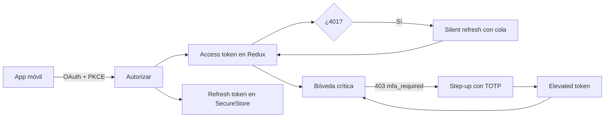

# Vault - Laboratorio de seguridad móvil

Vault es un laboratorio educativo de seguridad móvil desarrollado con Expo/React Native y Express. Integra OAuth 2.0 con PKCE, autenticación con estado anti-CSRF, silent refresh, autenticación de dos factores TOTP y acceso step-up a una bóveda crítica.

## Flujo de seguridad



## Requisitos

- Node.js LTS.
- Expo Go en un iPhone o teléfono compatible.
- PC y celular conectados a la misma red Wi-Fi.
- Windows con firewall permitido para Node.js.

## Ejecutar el backend

```powershell
cd backend-auth
npm install
Copy-Item .env.example .env
npm run dev
```

El servidor escucha en `0.0.0.0:4000`. Obtén la IP LAN:

```powershell
ipconfig
```

Usa la IPv4 de la conexión Wi-Fi/Ethernet. En Windows Defender Firewall permite Node.js en redes privadas si el teléfono no puede alcanzar el servidor.

## Ejecutar la app

```powershell
cd mobile-app
npm install
```

Crea `mobile-app/.env`:

```env
EXPO_PUBLIC_API_URL=http://TU_IP_LAN:4000
```

Luego:

```powershell
npx expo start
```

Escanea el QR con Expo Go. No uses `localhost` desde el teléfono físico.

## Credenciales demo

- Email: `estudiante@unisabana.edu.co`
- Contraseña: `Sabana2026*`
- Semilla TOTP: `JBSWY3DPEHPK3PXP`
- QR: `http://TU_IP_LAN:4000/dev/qr`

## Tests

```powershell
# App móvil
cd mobile-app
npm test
npx tsc --noEmit

# Backend
cd backend-auth
npm test
npm run build
npm run dev
npm run smoke
```

`npm run smoke` debe ejecutarse con el backend activo.

## Implementación por requisito

- **PKCE:** `src/auth/pkce.ts` genera verifier, challenge S256 y state; el intercambio está en `src/auth/oauthFlow.ts`.
- **State anti-CSRF:** `oauthFlow.ts` conserva el state en memoria y compara el recibido antes de intercambiar el code.
- **Tokens:** `src/store/authSlice.ts` conserva access/elevated tokens solo en Redux; `src/auth/tokenStorage.ts` conserva el refresh token y el secreto TOTP en SecureStore.
- **Silent refresh:** `src/api/client.ts` comparte una única `refreshPromise`, pausa nuevas peticiones y reintenta las respuestas 401 con una sola renovación.
- **TOTP RFC 6238:** `src/totp/base32.ts`, `src/totp/hmacSha1.ts` y `src/totp/totp.ts`; decodificación Base32, HMAC-SHA1 manual, contador de 30 segundos, offset dinámico y código de 6 dígitos.
- **Step-up:** `src/components/MfaModal.tsx` y `app/(tabs)/boveda.tsx`; el elevated token permite la bóveda durante su expiración.
- **Anti-replay:** el backend rechaza el mismo par usuario/código durante 90 segundos. La app muestra la respuesta 409 y el tiempo transcurrido desde la verificación.

## Cinco pruebas de aceptación

1. **Acceso Authenticator offline:** abre Inicio → Abrir Authenticator, configura una semilla manualmente o escaneando el QR. Deben verse el código y el anillo sin parpadeos ni red.
2. **OAuth y PKCE:** activa el modo demo CSRF, inicia sesión y verifica que el state alterado cancela el intercambio sin obtener tokens.
3. **Silent refresh:** en Inicio, lanza tres peticiones simultáneas con access token vencido. Las tres deben resultar exitosas y debe contar una sola renovación.
4. **Revocación:** revoca el refresh en el servidor, espera la expiración del access token y lanza las peticiones. La app debe borrar la sesión y volver al inicio.
5. **Step-up y replay:** abre Bóveda, verifica con el TOTP, entra a la bóveda y observa el contador elevado. Reenvía el último código en menos de 90 segundos y verifica la respuesta 409.

## Redirect URI

Expo Go genera normalmente una URI similar a:

```text
exp://192.168.x.x:8081/--/oauth/callback
```

El backend permite esta URI mediante el prefijo `exp://` y también acepta `unisabana-auth://` configurado como esquema de Expo. En un build nativo, `AuthSession.makeRedirectUri` puede resolver `unisabana-auth://oauth/callback`.
